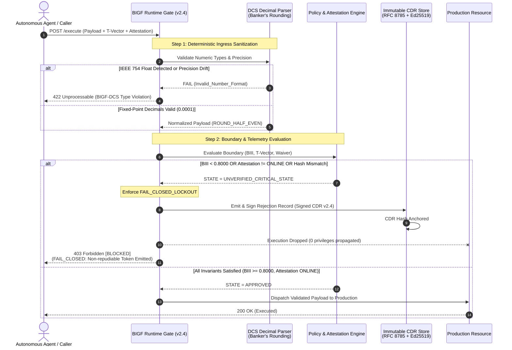

# Business Impact Governance Framework (BIGF) v2.4

> *"Talk is cheap. Show me the state machine. If your governance model requires a 15-person meeting to decide who has authority, your architecture is broken. You don't have governance; you have an expensive support group."*

**In plain English:** BIGF is a deterministic runtime gate that drops authority to zero (`403 Hard Halt`) the millisecond compliance telemetry goes offline, numerical precision drifts, or an autonomous system attempts an unverified state transition.

---

## Try It: Interactive Browser Simulator

You do not need to install complex enterprise software or deploy infrastructure to see the mechanics in action. A standalone reference simulator is available:

* **Download & Run:** [BIGF v2.3 Interactive Runtime Control-Plane Simulator (Zenodo DOI: 10.5281/zenodo.23255577)](https://doi.org/10.5281/zenodo.23255577)
* **Zero dependencies:** Download the single HTML file and open it locally in any modern browser. It executes 100% client-side with zero external frameworks or network calls.
* **What it demonstrates:**
  * Deterministic BIII integrity score evaluation ($\theta = 0.8000$)
  * Canonical Decision Record (CDR) cryptographic hash verification
  * Dual-executive statutory break-glass waiver validation (DORA / NIS2 alignment)
  * Attestation engine heartbeat and fail-closed failover mechanics
  * Simulated CI/CD pipeline enforcement with strict exit 1 termination

---

## The Execution Pipeline (BIGF v2.4 Sequence)

---

## Why This Exists: My Attempt at a Resistance

I have spent years inside enterprise IT watching talented engineers drown in process theater, compliance audits that inspect static Word documents instead of running code, and consulting firms billing millions for maturity models that change nothing in production.

I do not claim to hold universal truth, nor is this an attempt to establish academic dogma. **This is simply my personal attempt to build an engineering countermeasure against the governance theater.**

Instead of complaining in coffee rooms or sitting through another 18-month consulting assessment, I wanted to build something concrete: an architecture where subjective consensus is replaced by deterministic state machines.

> **"If you're tired of pretending that a meeting is governance, you're already part of the resistance."**

---

## The Problem: The 30-Year Consultant Grift

For three decades, enterprise IT operations have outsourced accountability to endless consulting loops, certification mills, and slide decks:

* **The Billable-Hour Trap:** Why solve a problem with deterministic math when a consultancy can sell you an 18-month "ITIL Maturity Assessment", followed by a multi-million-euro ServiceNow implementation that ends with the exact same manual dropdown: `Impact: High`?
* **Meeting-Driven Failure:** Modern incident management treats subjective shouting in a war room as operational telemetry. When an outage hits, 12 people debate whether the business is hurting while revenue drains in real time.
* **Dead-Tree BIA:** Organizations burn hundreds of hours writing ISO 22301 and ISO 27001 Business Impact Analyses. The moment the auditor signs off, the document is locked in SharePoint to die, never touching runtime code or deployment pipelines.
* **Metric Inversion:** Service Level Agreements (SLAs) are treated as drivers instead of lagging indicators. Teams play ticket-status ping-pong to pause contract timers while the actual business operation collapses.

---

## Core Axiom: Authority Over Truth

BIGF does not act as a philosophical oracle. It does not waste cycles arguing whether an alert represents "ontological reality." 

It solves a single runtime problem:
$$\text{Authority} = f(B, S, T)$$

* **$B$ (Business Impact Anchor):** Cryptographically anchored BIA tolerance parameters and consequence thresholds. BIA leads; SLA lags.
* **$S$ (State & Telemetry):** Canonical, tamper-evident operational state vector.
* **$T$ (Time Window):** Discrete, non-drifting temporal boundaries.

At timestamp $T$, the gate evaluates whether an entity holds the mathematical authority to trigger a state transition. If authority cannot be proven, authority is zero. 

No voting. No escalation matrices. No CAB approval delays.

---

## Architectural Invariants

BIGF v2.4 enforces strict deterministic invariants at the code level:

1. **Fail-Closed by Design ($O(1)$ Rejection):** Absence of explicit, verified authority results in immediate execution denial. The gate defaults to shut.
2. **Deterministic Canonicalization (RFC 8785):** Payloads must conform to RFC 8785 JSON Canonicalization Scheme (JCS). Structural ambiguity across different parser implementations is structurally impossible.
3. **Zero Floating-Point Drift:** IEEE 754 floats are banned. Numerical state evaluation runs strictly on fixed-point arithmetic (precision $10^{-4}$) using Banker's Rounding (half-to-even). Machine architecture differences will never alter a decision.
4. **Decoupled Execution Pipeline:**
   * Syntactic & Schema Validation (Input Gate)
   * RFC 8785 Cryptographic Integrity (Signature Gate)
   * Discrete Deterministic Evaluation (State Engine)
   * Binary Execution Permit or Hard Halt (Decision Gate)

---

## Where This Runs: Real-World Failure Modes

If you are looking for academic theory, read a textbook. BIGF is an engineering gate built for systems where failure is expensive:

* **Autonomous AI Agents & Rogue Execution:**
  * *The problem:* LLMs and autonomous agents executing external API calls or financial transactions based on "hallucinated confidence" or stale RBAC tokens.
  * *The BIGF gate:* The agent has zero authority without runtime, cryptographic attestation ($S$). If upstream compliance telemetry is down or delayed, authority drops to $0$. Hard halt. No money moves.
* **Autonomous Financial & Settlement Triggers:**
  * *The problem:* IEEE 754 floating-point drift altering micro-rounding thresholds across different cloud instances and corrupting audit logs.
  * *The BIGF gate:* Deterministic $10^{-4}$ fixed-point math with Banker's Rounding. Identical inputs produce bit-identical decisions across any node, any architecture, every single time.
* **The "Offline Compliance" Dilemma:**
  * *The problem:* Cloud microservices failing *open* when the authorization/compliance service times out or network partitions occur.
  * *The BIGF gate:* Strict fail-closed design. Missing proof is mathematically identical to a malicious attack. The default state is denied (`403`).
* **Incident Prioritization Without the Human Circus:**
  * *The problem:* War rooms shouting over whether a production issue is `P1` or `P2` while SLAs run out.
  * *The BIGF gate:* Runtime BIA anchoring. The business tolerance vector ($B$) dictates state transitions directly, bypassing subjective opinion.

---

## Official Publications & Specification

The immutable specification, architectural papers, and formal versions are registered with permanent DOIs in CERN's Zenodo repository:

* **Zenodo Community:** [Business Impact Governance Community](https://zenodo.org/communities/business-impact-governance/)
* **Concept DOI:** [10.5281/zenodo.22658623](https://doi.org/10.5281/zenodo.22658623)
* **Production Specification:** BIGF v2.4 (Deterministic / Fail-Closed Standard)
* **Interactive Simulator:** [BIGF v2.3 Control-Plane Simulator (DOI: 10.5281/zenodo.23255577)](https://doi.org/10.5281/zenodo.23255577)

---

## Keywords & Semantic Index

`fail-closed architecture` · `rfc-8785` · `json-canonicalization-scheme` · `bankers-rounding` · `business-impact-analysis` · `autonomous-agent-guardrails` · `ai-safety-gate` · `iso-22301-automation` · `incident-prioritization` · `deterministic-governance` · `zero-trust-runtime` · `anti-itil-theater`

---

## License & Usage

This framework, specification, and conceptual architecture are licensed under the **Creative Commons Attribution-NonCommercial 4.0 International License (CC BY-NC 4.0)**.

* **You are free to:** Share, read, reference, and build upon this research for academic, internal, and non-commercial verification purposes.
* **Attribution required:** You must give appropriate credit to **Erkki Laine** as the original author.
* **Non-Commercial restriction:** You may **not** package, rebrand, or sell this framework as a commercial product, consulting methodology, or proprietary toolkit without explicit written licensing.
